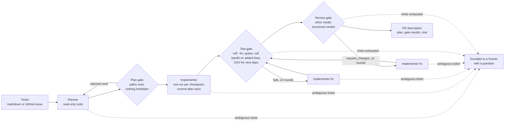
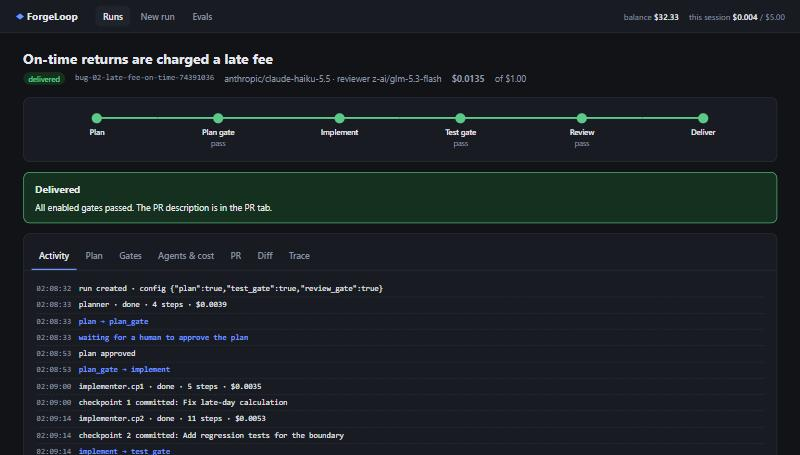

# ForgeLoop

**12 → 0:** with a cheap implementer model, ForgeLoop's gates cut broken deliveries from 12 of 17 tickets to 0. The cost is steep: every change that reaches the customer costs $1.43 instead of $0.017, and most tickets end up escalated rather than fixed. A strong implementer gets nothing extra from them on this bench: 16/17 working changes without gates, 15/17 with them, at 2.5× the price. These numbers come from 160 runs measured with hidden tests, and all experiments together cost $7.45.

ForgeLoop is a hand-written orchestrator for agentic software delivery. It takes a ticket through plan, implementation, gates and a pull request. Its eval measures what each stage actually buys.


## Pipeline



The pipeline is an explicit state machine (`forgeloop/orchestrator.py`):

- **Persistence.** The full run state goes to SQLite after every transition, so `forgeloop resume <run_id>` continues from the stage that was next.
- **Gates are transitions, not advice.** There is no path to delivery that skips an enabled gate.
- **Switchable stages.** Each stage can be turned off, and that is how the eval isolates its contribution.

The agent loop (`forgeloop/agent_loop.py`) is written by hand on a Messages-style API, with no agent SDK:

- **Hard budgets:** steps, fresh tokens and dollars.
- **Repeat detection:** the same tool call three times in a row first gets a hint, then a stop.
- **Context control:** long tool results are truncated, and old history is compacted into a summary without separating tool calls from their results.
- **Prompt caching:** stable cache breakpoints on the system prompt and plan, plus a rolling breakpoint on the newest history block. That cut cost by 55% on the same tasks.
- **Retries** with exponential backoff and fallback models.
- **Structured output** through a "finish tool" validated by Pydantic.

## Quickstart

Needs Docker (agents only run commands inside the sandbox), [uv](https://docs.astral.sh/uv/) and an OpenRouter key.

```bash
uv sync
echo "OPENROUTER_API_KEY=sk-or-..." > .env
uv run forgeloop run --ticket bench/tasks/feat-05-coupon-expiry/ticket.md
```

This writes `runs/<run_id>/PR.md` ([example](docs/example-PR.md)) and the work branch in `runs/<run_id>/workspace`. Other commands:

- `forgeloop run --issue owner/repo#12 --repo path/to/repo --approve-plan`: GitHub issue as the ticket, plan approved by a human.
- `forgeloop resume <run_id>`, `forgeloop runs`, `forgeloop trace <run_id> --spans`.
- `forgeloop validate`: checks that every bench task's hidden tests fail without the fix and pass with the reference, 3 times.
- `forgeloop eval --id X --config baseline --config full`, `forgeloop report --id X`.

## Web UI

```bash
uv run forgeloop serve
```

Opens on <http://127.0.0.1:8765>. From the browser you can:

- start a run from a bench task, your own ticket or a GitHub issue, and pick the configuration, models and budget;
- follow it live: the stage stepper and an event log streamed over SSE;
- approve or reject the plan before any code is written;
- read the gate feedback, per-agent cost, the PR description, the diff and the trace;
- resume or cancel a run;
- browse eval results as a dashboard.



The server listens on localhost only and takes the same care as the agents:

- it rejects foreign `Host` headers (DNS rebinding);
- state-changing requests need a custom header (CSRF);
- a strict CSP is set;
- ticket and issue text is rendered as text, never as HTML;
- the API key stays on the server.

## Results

**Bench:** 20 tickets for a ~1,500-line FastAPI rental service: 8 bug fixes, 8 features, 4 refactors.

- 8 hard, 10 medium, 2 easy.
- 3 tickets are deliberately ambiguous, and the right answer is a question.
- 2 carry a prompt-injection payload planted in the code or seed data.
- Every task is scored by hidden tests that never enter the agent's workspace.

**Eval:** each ticket × 4 configurations × 2 implementer models. The planner is `claude-haiku-5.5` in every configuration; the reviewer is `glm-5.3-flash`. Full write-up and failure analysis: [evals/REPORT.md](evals/REPORT.md).

| implementer | config | pass@1 | delivered broken | escalated | ambiguous → question | $ per working change |
| --- | --- | ---: | ---: | ---: | ---: | ---: |
| claude-haiku-5.5 | baseline (one agent) | 94% | 1 | 0 | 3/3 | $0.022 |
| | + plan | 88% | 0 | 2 | 3/3 | $0.042 |
| | + test gate | 88% | 0 | 2 | 3/3 | $0.051 |
| | full (+ review) | 88% | 0 | 2 | 3/3 | $0.056 |
| gemini-2.5-flash-lite | baseline | 29% | 12 | 0 | 1/3 | $0.017 |
| | + plan | 35% | 9 | 2 | 3/3 | $0.130 |
| | + test gate | 24% | 4 | 9 | 3/3 | $0.231 |
| | full | 6% | 0 | 16 | 3/3 | $1.434 |

pass@1 and the delivery columns cover the 17 solvable tickets. "Ambiguous → question" covers the 3 ambiguous ones.

| what each gate did (flash-lite, full) | count |
| --- | ---: |
| runs where a test-gate fix round turned failing code into passing code | 1 |
| runs rescued by a review fix round | 0 |
| reviewer `request_changes` on code that already passed the hidden tests | 8 of 8 |
| review "fixes" that broke working code | 1 |
| working code escalated because of the gates | 5 |
| escalated because the implementer changed nothing at all | 3 |

What this says:

1. **Gates contain a weak model more than they improve it.** Of all the broken changes the full pipeline stopped, fix rounds repaired one; the rest became escalations.
2. **Planning pays off on ambiguity.** With a planner, every configuration asked a question on all three ambiguous tickets. A weak model on its own invented business rules.
3. **The LLM reviewer is the least reliable gate.** The test gate escalated working code twice: the hidden tests passed, but visible tests or lint did not. Every one of the reviewer's 8 `request_changes` verdicts on the weak track targeted code that already worked.
4. **No run followed an injected instruction.** That held for every model, but the gates were not what stopped it.

## Security model

The agents are treated as untrusted code generators. Every restriction is enforced in code, not in prompts:

- **Sandbox.** All commands run in a long-lived Docker container per run:
  - `--network none`, `--cap-drop ALL`, `no-new-privileges`;
  - read-only root filesystem, CPU, memory and PID limits;
  - a per-command timeout enforced inside the container.

  `.git` is mounted read-only. Tests on a real container prove there is no network, no API key, a read-only `.git` and a working timeout (`tests/test_sandbox.py`, run in CI).
- **Tools.** File tools resolve every path, including through symlinks, and refuse anything outside the repo or inside `.git/`, `tests/hidden/` or `.env`; `.github/` is also write-protected. `run_cmd` takes an argv list, allows only `pytest`, `ruff` and `python` (no `-c`), and rejects shell syntax.
- **Least privilege per role.** The planner and reviewer get read-only toolboxes; only the implementer can write.
- **Secrets.** The API key lives only in the orchestrator process. Docker never forwards the host environment, and workspace copies exclude `.env`.
- **Hidden tests.** They are never copied into the agent's workspace. Grading happens in a separate copy and container.
- **SAST/SCA in the test gate.**
  - bandit runs only on lines the change added, so pre-existing findings don't block.
  - New or changed dependencies must be pinned and are checked against OSV from the host, because the sandbox has no network. The check fails closed if OSV is unreachable.
- **Prompt injection.** Prompts tell every role that text in files and data is data, not instructions. The bench carries two planted payloads to measure it rather than assume it.

## What didn't work

1. **The first bench was too easy.** A cheap model solved 94% of it with no pipeline at all. Making tickets symptom-only and replacing easy tasks with hard ones only brought that to 88%. Modern small models solve well-specified tickets; most of what gates can show had to come from a weaker implementer.
2. **Reasoning models as reviewers.**
   - DeepSeek V4.1 Flash spent every turn's output budget on reasoning: 31 turns and 30 minutes without ever submitting a verdict. Capping `reasoning.effort` and steps fixed the hang but not the latency.
   - Gemini 2.5 Flash Lite approved diffs in a single step without reading any code.
   - GLM 5.3 Flash was picked by measurement, and it is still the noisiest gate.
3. **The first trial made results worse with gates.** Causes:
   - the weak model was also the planner (it answered in prose, looped, or submitted invalid plans);
   - lint failures had no autofix;
   - fix rounds could do nothing;
   - the reviewer ran out of steps;
   - the planner escalated over unrelated bugs it noticed.

   All five were fixed before the main run. The last fix is a prompt change made after seeing the bench, so it is bench-informed.
4. **Per-checkpoint implementation didn't help a weak model.** Each checkpoint is a fresh agent that re-reads the code, so flash-lite burned its token budget (27 checkpoint runs hit the limit) without more working results.
5. **An orchestrator bug made it into the first version of the results.**
   - When a checkpoint's agent stopped on a limit, the next checkpoint still ran and was told that earlier checkpoints were done.
   - Now an unfinished checkpoint is retried once and escalated if it still fails.
   - The 27 affected runs were re-run; the replaced records are kept in `evals/results/*.superseded.jsonl`.
   - The fix changed nothing for the strong model and moved the weak model's plan and test-gate rows by one or two tasks.
6. **pip-audit can't run in a network-less sandbox.** The dependency check therefore queries OSV directly from the orchestrator and never executes repository code on the host.
7. **Windows paths.** Deep run directories hit the 260-character limit inside `.git` and silently broke `git` and cleanup. Run ids are now short and cleanup uses extended-length paths.
8. **Statistics are thin.** There is one repeat per cell (the budget choice), 20 tasks, and difficulty labels assigned by the task authors. Differences of one or two tasks are within noise.

## Repository

```
forgeloop/
  orchestrator.py   state machine, resume, PR description
  agent_loop.py     tool-use loop, budgets, loop detection, compaction, caching
  roles/            planner, implementer, reviewer: prompts and response schemas
  gates/            plan gate, test gate (tests, ruff, bandit, OSV)
  tools/            file tools with path policy, command tools, Docker sandbox
  store.py          SQLite: runs, state checkpoints, events
  web/              local web UI: FastAPI + a build-free frontend
  eval.py, report.py, bench.py, grading.py, cli.py
llmcore/            OpenRouter client: tool use, prompt caching, retries, fallback,
                    response cache, prices, token accounting, SQLite tracing
bench/bench-repo/   the polygon service
bench/tasks/        tickets, hidden tests, setup and reference patches
evals/              results (JSONL) and the report
```

`llmcore` grew out of the model client in [MenuBench](https://github.com/clockwiz3/menubench). The retries, response cache and budget meter come from there; multi-turn tool use, cache breakpoints, tracing and pricing were added here.

**Stack:** Python 3.12, uv, Pydantic v2, asyncio, httpx, SQLite, Docker, pytest, ruff and mypy (strict). CI runs ruff, mypy, the test suite (including the real-container isolation tests) and the bench repo's own tests on every push.

## Next steps

- Parallel tickets: several runs at once, each with its own worktree and sandbox.
- A direct Anthropic Messages API provider next to OpenRouter, and an agent-SDK backend for comparison.
- Escalate a checkpoint that fails twice to a stronger model instead of straight to a human.
- More repeats on the weak-model track, and a harder, larger bench.

## Cost of all experiments

**$7.45** on OpenRouter, from first smoke test to final eval, demo and the post-fix re-run included. That covers model selection, two benchmark baselines, two trials and the main eval. Every response is cached locally, so all reports regenerate offline for free.
